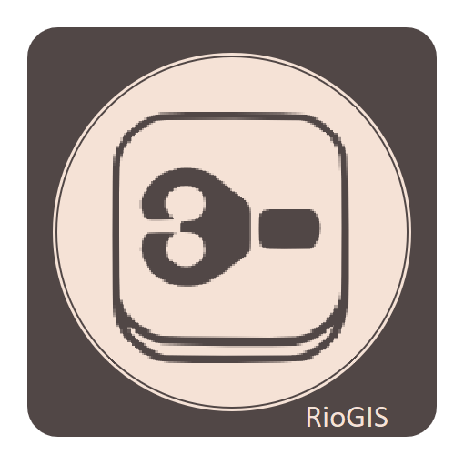

QGIS plugin exports attributes of a given feature to a Norwegian module of WinCan VX.

# Acknowledgments
* [QGIS](https://github.com/qgis/QGIS)

## Azure Storage dependency on Windows

The plugin can be loaded without the Azure SDK. Synchronization and upload require
`azure-storage-blob`; if it is missing, RioGIS displays installation instructions.

Install the package in the Python environment used by the same QGIS installation:

1. Close QGIS and open its OSGeo4W Shell.
2. Run `python -m pip install --user azure-storage-blob`.
3. Restart QGIS.

Do not install the package into an unrelated system Python. See the
[OSGeo4W instructions for external Python packages](https://trac.osgeo.org/osgeo4w/wiki/ExternalPythonPackages).
QGIS's `plugin_dependencies` metadata is for other QGIS plugins, not Python packages
([QGIS plugin documentation](https://docs.qgis.org/latest/en/docs/pyqgis_developer_cookbook/plugins/plugins.html#metadata-txt)).

